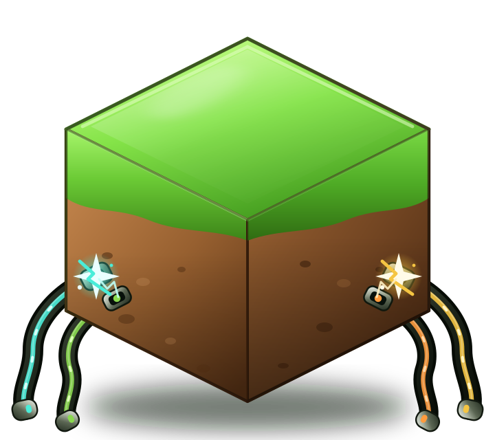

# WorldsHub для macOS

[English](README.md) · **Русский** · [Сайт](https://vladyio.github.io/worldshub-macos/ru/)

> [!NOTE]
> This is a completely vibe-coded and unofficial implementation of WorldHub for macOS. It is provided as is and has been done as a proof-of-concept (and also to help some people play).
>
> Это полностью «вайб-кодинг» и неофициальная реализация WorldHub для macOS. Предоставляется как есть, сделана как proof-of-concept (а также чтобы помочь некоторым людям поиграть).

<p align="center">
  
</p>

[](https://github.com/vladyio/worldshub-macos/releases/latest/download/WorldsHub-macOS-arm64.zip)

Тонкая Electron-обёртка вокруг официального веб-клиента WorldsHub, у которой Windows-зависимые части пересобраны для macOS. Позволяет **подключаться и хостить** миры Minecraft. Транспорт — WebRTC, проброс портов не нужен.

Только Apple Silicon (arm64).

## 1. Установка и запуск

1. Скачайте `WorldsHub-macOS-arm64.zip` из [Releases](https://github.com/vladyio/worldshub-macos/releases/latest) и распакуйте.
2. Перетащите `WorldsHub.app` в `/Applications`.
3. Запустите приложение. При первом запуске macOS может его заблокировать — решения ниже.

### 1.1 Подключение к миру

1. Войдите в свой аккаунт WorldsHub.
2. Выберите мир, который хостит другой игрок, и нажмите **Connect**.
3. Если macOS спросит доступ к локальной сети — разрешите.
4. В Minecraft Java Edition: **Сетевая игра → Прямое подключение → `localhost:25565`**.

### 1.2 Хостинг мира

1. В WorldsHub создайте сервер Minecraft: выберите версию и папку, примите EULA и дайте приложению скачать серверный jar.
2. Нужна Java 17 или новее. Если подходящей Java нет, нажмите **Install JDK 21** в окне сервера.
3. Запустите сервер и дождитесь статуса «running».
4. Нажмите **Host**, выберите видимость и число игроков, поделитесь инвайт-кодом или миром из списка.
5. Другие игроки подключаются через WorldsHub и заходят на `localhost:25565` в Minecraft.
6. Не закрывайте приложение во время хостинга — при выходе сервер остановится.

### 1.3 Проблемы и ошибки

- **«WorldsHub.app повреждён» или «Apple не может проверить приложение»** — сборка подписана ad-hoc, без нотаризации. Нажмите правой кнопкой по приложению → **Открыть** → **Открыть**. Если не помогло, выполните:
  `xattr -dr com.apple.quarantine /Applications/WorldsHub.app`
  или используйте **Системные настройки → Конфиденциальность и безопасность → Всё равно открыть**.
- **Не подключается к `localhost:25565`** — порт должен быть свободен. Остановите другой сервер Minecraft на порту 25565 и переподключитесь.
- **«Invalid or expired authorization token»** — выйдите из аккаунта WorldsHub и войдите снова.
- **Нет миров / хост недоступен** — хост должен быть онлайн и продолжать хостинг.
- **Доступ к локальной сети запрещён** — включите его в **Системные настройки → Конфиденциальность и безопасность → Локальная сеть**. Без этого прямое подключение может не работать (TURN-релей иногда спасает).
- **Сервер не запускается** — проверьте, что установлена Java 17+, порт 25565 свободен, а в логе сервера в приложении нет ошибки.
- **Закрытие приложения останавливает хостинг** — сервер Minecraft запущен как дочерний процесс приложения.
- **Нет сборки для Intel** — этот релиз только для arm64.

## 2. Структура приложения и схема работы

```
main.js                                  главный процесс Electron: окно, IPC-мост, жизненный цикл
preload.js                               contextBridge -> window.electron (sendToProcess/onEvent/invoke)
client.js                                signaling клиента, WebRTC, локальный прокси
host.js                                  signaling хоста, WebRTC, управление клиентами
minecraft-server-manager.js              опрос локального сервера Minecraft
minecraft-datachannel-parser.js          парсер пакетов Minecraft для login/status
main-process/ipc-handlers.js             IPC-обработчики клиента и хоста
main-process/utils/jdk-utils.js          поиск Java и установка JDK 21
main-process/utils/minecraft-installer.js    скачивание серверного jar и EULA
main-process/utils/minecraft-server-runner.js  запуск и остановка Java-процесса
main-process/utils/server-properties.js  чтение/запись server.properties
main-process/utils/electron-minecraft-server-config.js  ops.json
main-process/utils/turn-servers.js       TURN-данные с бэкенда
```

UI не входит в сборку. `main.js` загружает `https://app.worldshub.io` — так же, как официальное приложение, — и через `preload.js` предоставляет тот же IPC-интерфейс. Сайт отвечает за логин, список миров, установку сервера и интерфейс; Electron занимается P2P-соединением и локальным процессом сервера Minecraft.

Схема подключения:

1. Веб-интерфейс вызывает `window.electron.sendToProcess('connect-to-host', { serverId, token, ... })`.
2. `main.js` через IPC-обработчик передаёт вызов в `client.connectToHost(...)`.
3. `client.js` открывает Socket.IO-соединение с `app.worldshub.io` и регистрируется как клиент с JWT пользователя.
4. После `client_authorized` создаётся WebRTC peer connection (`node-datachannel`), а offer, answer и ICE-кандидаты проходят через signaling-сервер.
5. TCP-прокси на `127.0.0.1:25565` передаёт трафик Minecraft через WebRTC data channel хосту.
6. Логи, статусы и уведомления возвращаются в UI сообщениями `ui-event`.

Схема хостинга:

1. UI устанавливает и запускает сервер Minecraft через `start-minecraft-server`; процесс живёт под приложением.
2. Кнопка **Host** отправляет `start-hosting` с токеном и конфигом сервера.
3. `host.js` проверяет `127.0.0.1:25565`, регистрируется как хост и принимает WebRTC-offer'ы от клиентов.
4. Для каждого клиента создаётся свой data channel; `host.js` соединяет его по TCP с локальным сервером Minecraft.
5. Список клиентов, счётчик игроков, инвайты, кики и статусы уходят в UI.

### Сборка из исходников

Нужны macOS arm64 и Node.js.

```bash
npm install
npm test           # RTC, поиск JDK, запуск сервера
npm start          # запуск для разработки
npm run build      # -> dist/mac-arm64/WorldsHub.app
codesign --force --deep --sign - dist/mac-arm64/WorldsHub.app
```

`npm run test:host` — тяжёлый end-to-end тест: поднимает настоящий сервер Minecraft и локальный signaling, затем подключает фейковый WebRTC-клиент через хост. Нужен серверный jar в `/tmp/wh-mc-server/server.jar` (или путь в `WORLDSHUB_TEST_SERVER_JAR`).

Если npm блокирует install-скрипты: `npm install-scripts approve electron node-datachannel && npm rebuild`.

### Автоматические обновления

[Workflow синхронизации](.github/workflows/sync-upstream.yml) ежедневно проверяет официальный `latest.yml`. Когда версия upstream меняется, он скачивает и проверяет новый установщик, копирует клиентский и хостовый код, заново применяет патчи из `patches/`, ставит зависимости, запускает тесты, собирает и подписывает приложение и публикует новый релиз. Версия приложения увеличивается отдельно; версия upstream хранится в `package.json` в поле `upstreamVersion`.

Если upstream изменит код в месте патча, workflow упадёт до публикации — обновите патч и запустите снова. Ручной запуск: `gh workflow run sync-upstream.yml -f force=true`.

## Лицензия

Общественное достояние — см. [LICENSE](LICENSE).
